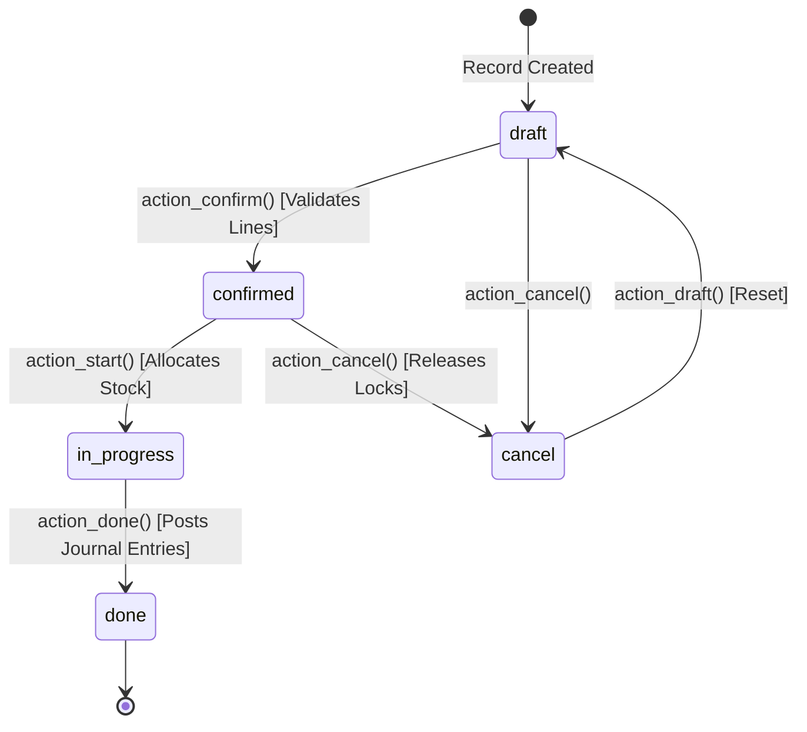
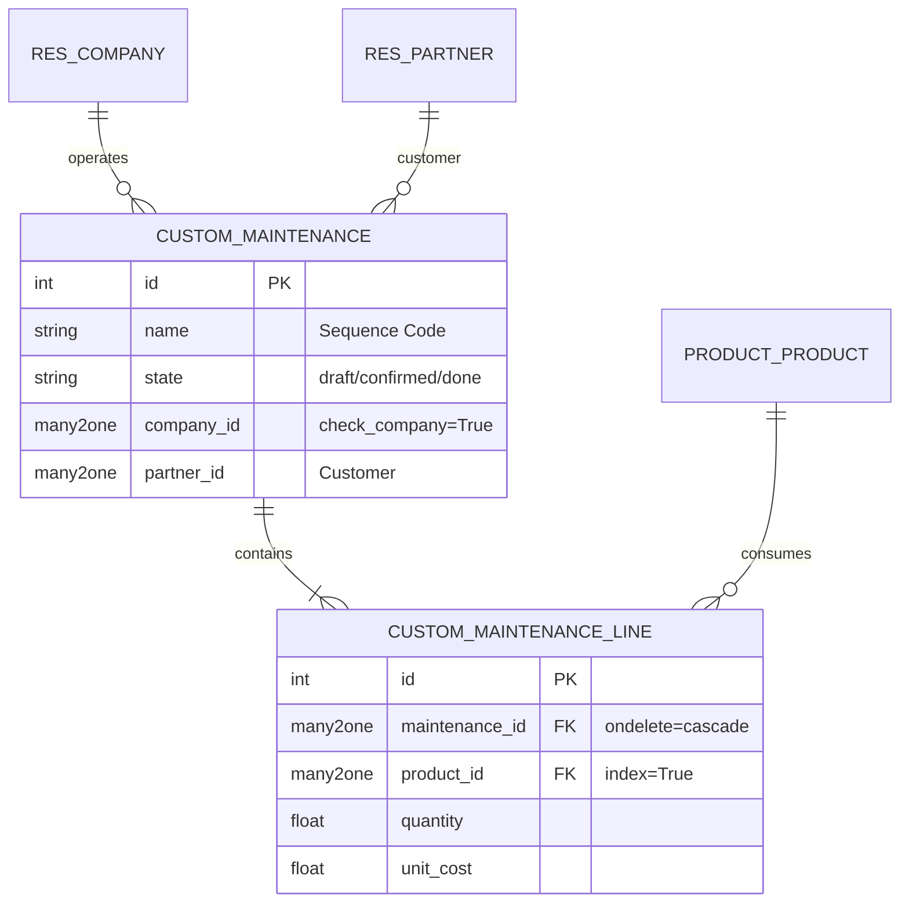

# Odoo Architectural Blueprint & Pre-Flight Design (Principal Standard)

Before writing custom code or refactoring enterprise modules, a Principal Engineer designs a crystal-clear architectural blueprint. This eliminates costly rework, prevents broken state transitions, and guarantees flawless data integrity.

---

## 1. The 4 Essential Pillars of an Odoo Architectural Blueprint

### A. State Machine & Lifecycle Transitions (`mermaid stateDiagram-v2`)
Every business model with a `state` field must have an explicit lifecycle diagram:
- Define valid state transitions: e.g., `draft` -> `confirmed` -> `in_progress` -> `done` (and `cancel`).
- Specify transition methods (`action_confirm`, `action_done`, `action_cancel`).
- Declare immutable states: fields become `readonly="state == 'done'"`.
- Declare cancellation policies: records in `done` state cannot be reset to draft without explicit supervisor reversal / journal unposting.

Example:

### B. Entity-Relationship Data Model (`mermaid erDiagram`)
Map all relational dependencies and cascade policies before creating models:
- **`Many2one`**: Specify `ondelete='cascade'` (for child lines), `ondelete='restrict'` (for master data references), or `ondelete='set null'`.
- **Multi-Company Isolation**: Every operational model must declare `company_id` and relational fields must include `check_company=True`.
- **Composite Indexes**: Identify fields queried together in filters/group-bys and define `_table_query` or composite PostgreSQL indexes.

Example:

### C. Financial & Stock Accounting Impact Matrix
Explicitly identify if and when a document touches the general ledger or stock valuation:
1. **Financial Accounting**:
   - Which state transition creates an `account.move`?
   - What account is debited, and what account is credited? (`debit == credit`).
   - What is the tax mapping and analytic account distribution?
2. **Inventory Valuation**:
   - Does this move physical stock? Which location (`location_id` -> `location_dest_id`)?
   - Is it standard, AVCO, or FIFO costing?
   - What stock valuation layer (`stock.valuation.layer`) is generated?

### D. Interactive Button & Action Traceability Matrix
Map every UI action to its backend handler:

| UI Button / Action | Method Name | Required Group | Invisible Condition | Side Effects |
| :--- | :--- | :--- | :--- | :--- |
| **Confirm** | `action_confirm()` | Standard User | `state != 'draft'` | Validates required lines, assigns sequence number |
| **Start Work** | `action_start()` | Technician | `state != 'confirmed'` | Sets technician ID, starts work order timer |
| **Mark Done** | `action_done()` | Manager | `state != 'in_progress'` | Creates stock moves, posts clearing account entries |
| **Cancel** | `action_cancel()` | Standard User | `state in ('done', 'cancel')` | Releases allocated inventory, cancels pending crons |

---

## 2. Using Blueprint Mode in Conversations

Whenever you request a new module or complex feature, Antigravity will automatically provide this **Pre-Flight Architectural Blueprint** in Turn 1, ensuring zero misunderstandings and a complete implementation that adheres to real ERP business rules.
